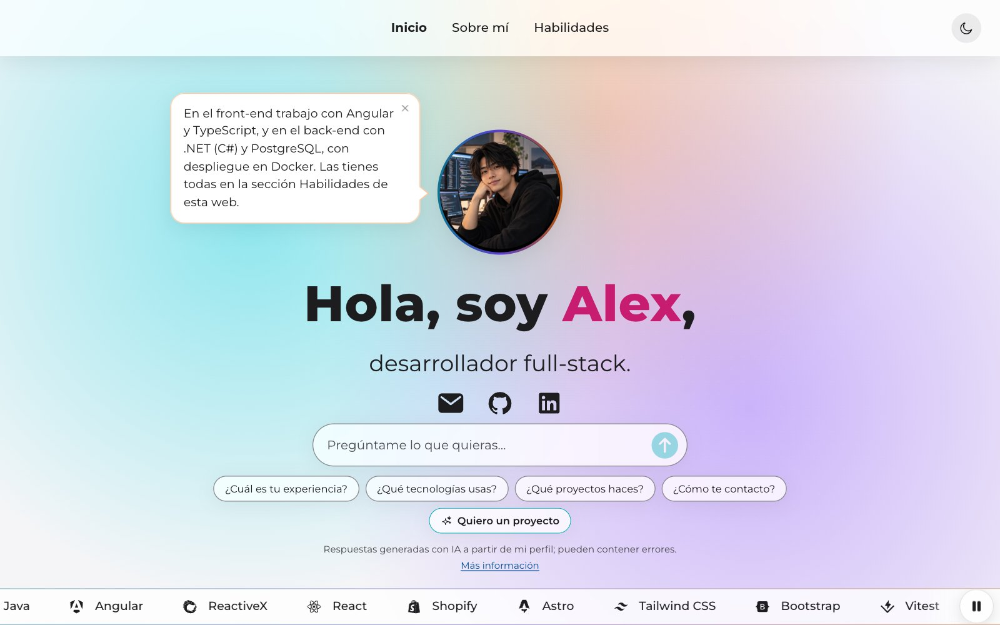
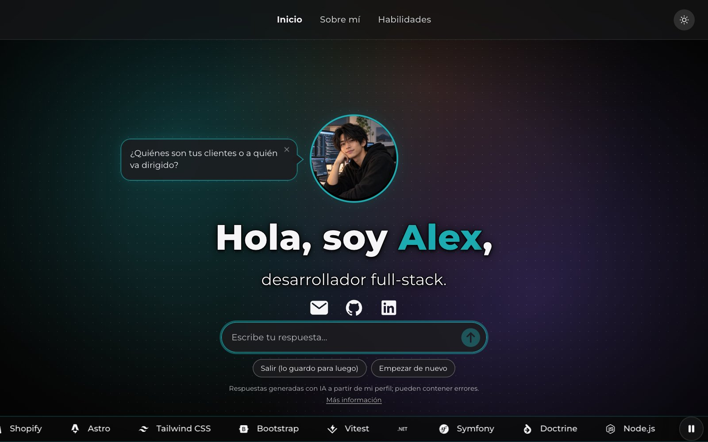
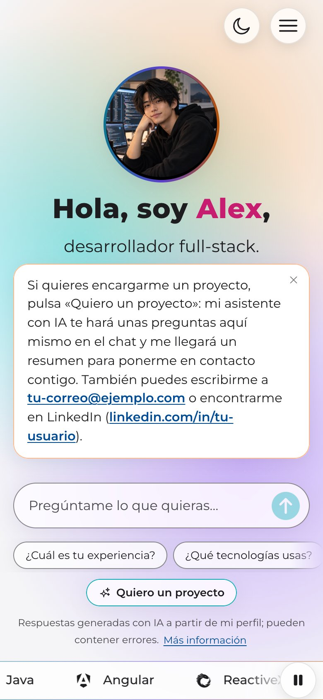
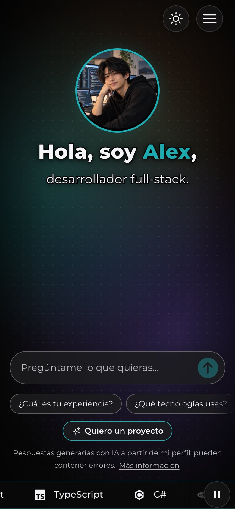

# Plantilla de portfolio con IA

**[English version](README.en.md)**

Plantilla de portfolio personal para desarrolladores y creativos, con un **chat de IA que responde preguntas sobre ti** y un **formulario inteligente** que entrevista a quien quiere encargarte un proyecto y te envía el resumen por **Telegram**.

- **Web:** Angular 21 (componentes standalone y signals).
- **API:** .NET 9.
- **IA a tu elección:** [Ollama](https://ollama.com) en tu ordenador o servidor (gratis y sin que los datos salgan de él) o cualquier servicio compatible con la API de OpenAI (OpenAI, OpenRouter, Groq, Mistral…). Viene **sin ninguna IA conectada**: tú eliges cuál.
- **Despliegue:** Docker.

> **Licencia: uso libre no comercial.** Puedes usarla, modificarla y compartirla para tu portfolio personal, pero **no venderla ni usarla para hacer webs a clientes**. Detalles en [Licencia](#licencia).

<p align="center">
  
  
</p>
<p align="center">
  
  
</p>

Así se ve con la foto de ejemplo y sin ilustración propia (fondo degradado, sin nada en movimiento). Cambia la foto por la tuya y, si quieres, añade tu dibujo animado: ver [Animación del inicio](#animación-del-inicio).

---

## Índice

1. [Qué incluye](#qué-incluye)
2. [Requisitos](#requisitos)
3. [Ponla en marcha, paso a paso](#ponla-en-marcha-paso-a-paso)
4. [Conectar la IA](#conectar-la-ia)
5. [Personalizar](#personalizar)
6. [Animación del inicio](#animación-del-inicio)
7. [Cómo funciona la IA](#cómo-funciona-la-ia)
8. [Qué modelo elegir](#qué-modelo-elegir)
9. [Recibir las solicitudes por Telegram](#recibir-las-solicitudes-por-telegram)
10. [Publicar en internet](#publicar-en-internet)
11. [Problemas frecuentes](#problemas-frecuentes)
12. [Accesibilidad y seguridad](#accesibilidad-y-seguridad)
13. [Estructura del proyecto](#estructura-del-proyecto)
14. [Licencia](#licencia)

---

## Qué incluye

- **Inicio con animación propia (opcional):** tu ilustración fotograma a fotograma. Sin ilustración, se ve el fondo de luces de GlassMarshmallow.
- **Chat de preguntas rápidas:** los visitantes preguntan («¿Cuál es tu experiencia?», «¿Qué tecnologías usas?»…) y la IA responde en tu nombre, en bocadillos de cómic, palabra a palabra según genera la respuesta.
- **Formulario inteligente («Quiero un proyecto»):** un asistente con IA hace las preguntas que haría una consultora, distintas según el tipo de proyecto. Al final, el visitante revisa un resumen y te lo envía por Telegram.
- **Habilidades** en un acordeón con logos de tecnologías, y una franja animada con los logos.
- **Modo claro y oscuro**, adaptado a móvil.
- **Accesibilidad WCAG 2.2 AA:** teclado, lectores de pantalla, contraste y «reducir movimiento».
- **Páginas de privacidad y aviso legal**, y una página de **información sobre la IA** (transparencia).

---

## Requisitos

| Para | Necesitas |
|---|---|
| La web | [Node.js 22](https://nodejs.org) |
| La API | [.NET 9 SDK](https://dotnet.microsoft.com/download) |
| La IA (opcional) | [Ollama](https://ollama.com) **o** una clave de un servicio compatible con OpenAI. Ver [Conectar la IA](#conectar-la-ia) |
| Publicarla | [Docker](https://www.docker.com) con Docker Compose |

---

## Ponla en marcha, paso a paso

Sigue los pasos en orden. Al final tendrás la web funcionando en tu ordenador.

### Paso 1. Consigue el código

- **Con GitHub (recomendado):** pulsa el botón verde **«Use this template» → «Create a new repository»** en la página de este repositorio. Tendrás tu propia copia, que podrás modificar y publicar. Después descárgala:

  ```bash
  git clone https://github.com/TU-USUARIO/TU-REPOSITORIO.git
  cd TU-REPOSITORIO
  ```

- **Sin GitHub:** pulsa **«Code» → «Download ZIP»**, descomprímelo y abre una terminal en esa carpeta.

### Paso 2. Pon tus datos

Antes de arrancarla, cambia el ejemplo («Alex Ejemplo») por tus datos. Lo mínimo:

1. **`src/app/core/data/profile.data.ts`**: tu nombre, profesión, correo, GitHub, LinkedIn y el texto de «Sobre mí».
2. **`api/appsettings.json` → `"Perfil"`**: tu nombre, correo y enlaces (los que usa la IA).
3. **`api/perfil.md`**: lo que la IA sabe de ti (experiencia, tecnologías, respuestas modelo…). Ver [Consejos para `api/perfil.md`](#consejos-para-apiperfilmd).

El resto (habilidades, animación, textos legales) lo puedes hacer después: ver [Personalizar](#personalizar).

### Paso 3. Arranca la API

Abre una terminal en la carpeta del proyecto:

- **Mac o Linux:**

  ```bash
  cd api
  ASPNETCORE_URLS=http://localhost:5090 dotnet run
  ```

- **Windows (PowerShell):**

  ```powershell
  cd api
  $env:ASPNETCORE_URLS="http://localhost:5090"; dotnet run
  ```

Déjala abierta. Cuando ponga `Now listening on: http://localhost:5090`, está lista.

### Paso 4. Arranca la web

Abre **otra** terminal en la carpeta del proyecto (no en `api`):

```bash
npm ci
npm start
```

La primera vez, `npm ci` tarda un par de minutos. Cuando termine, abre **http://localhost:4200** en el navegador. La web pasa las llamadas a `/api` a la API del puerto 5090 (`proxy.conf.json`).

### Paso 5. Conecta la IA

Sin IA, la web funciona pero el chat responde «La IA de este portfolio todavía no está conectada». Elige una opción en [Conectar la IA](#conectar-la-ia) y reinicia la API (en su terminal, `Ctrl + C` y vuelve a lanzar el comando del paso 3).

### Paso 6. Comprueba que todo funciona

1. Abre **http://localhost:5090/api/health**. Debe poner `"status":"ok"` y, en `"ia"`, la IA que has elegido (`ollama` u `openai`).
2. En la web, escribe **«hola»** en el chat: debe saludarte con tu nombre.
3. Pulsa una pregunta rápida, por ejemplo «¿Qué tecnologías usas?»: la respuesta debe salir de tu `api/perfil.md`.
4. Pulsa **«Quiero un proyecto»** y contesta un par de preguntas.

Sin Telegram configurado, las solicitudes del formulario inteligente se guardan en `api/solicitudes/` (carpeta en `.gitignore`, porque contiene datos personales). Para recibirlas en el móvil, ver [Recibir las solicitudes por Telegram](#recibir-las-solicitudes-por-telegram).

Si algo no funciona, mira [Problemas frecuentes](#problemas-frecuentes).

---

## Conectar la IA

La plantilla viene **sin ninguna IA conectada**. Elige una de estas dos opciones. Tus claves van en **`api/appsettings.Local.json`**, un archivo que tienes que crear tú y que **no se sube a git** (está en `.gitignore`). En Docker van en el `.env` (ver [Publicar en internet](#publicar-en-internet)).

| | Ollama | Servicio compatible con OpenAI |
|---|---|---|
| **Dónde funciona** | En tu ordenador o tu servidor | En los servidores del servicio |
| **Coste** | Gratis | Según el servicio (suele cobrar por uso) |
| **Privacidad** | Lo que escriben los visitantes no sale de tu equipo | Lo que escriben los visitantes se envía al servicio |
| **Necesitas** | Un equipo con unos 6 GB de RAM libres | Una cuenta y una clave del servicio |

### Opción A: Ollama (en tu equipo)

1. Instala **[Ollama](https://ollama.com/download)** y ábrelo.
2. Descarga un modelo (ver [Qué modelo elegir](#qué-modelo-elegir)):

   ```bash
   ollama pull qwen3:8b
   ```

3. Crea el archivo **`api/appsettings.Local.json`** con esto:

   ```json
   {
     "IA": { "Proveedor": "ollama" },
     "Ollama": { "BaseUrl": "http://localhost:11434/", "Model": "qwen3:8b" }
   }
   ```

4. Reinicia la API.

### Opción B: un servicio compatible con OpenAI

1. Crea una cuenta en el servicio y genera una **clave de API** (API key).
2. Crea el archivo **`api/appsettings.Local.json`** con la dirección, el modelo y tu clave:

   ```json
   {
     "IA": { "Proveedor": "openai" },
     "OpenAI": {
       "BaseUrl": "https://api.openai.com/v1/",
       "Model": "gpt-4o-mini",
       "ApiKey": "TU_CLAVE"
     }
   }
   ```

3. Reinicia la API.

Algunos servicios y su dirección (`BaseUrl`). El nombre del modelo lo encuentras en la documentación de cada uno:

| Servicio | `BaseUrl` |
|---|---|
| [OpenAI](https://platform.openai.com) | `https://api.openai.com/v1/` |
| [OpenRouter](https://openrouter.ai) (muchos modelos, algunos gratis) | `https://openrouter.ai/api/v1/` |
| [Groq](https://console.groq.com) | `https://api.groq.com/openai/v1/` |
| [Mistral](https://console.mistral.ai) | `https://api.mistral.ai/v1/` |
| [LM Studio](https://lmstudio.ai) (en tu ordenador, sin clave) | `http://localhost:1234/v1/` |

**Importante si usas un servicio externo:**

- **Nunca subas tu clave a git** ni la pongas en `appsettings.json`: quien la tenga puede gastar a tu cargo. Usa `api/appsettings.Local.json` en local y el `.env` en el servidor.
- Pon un **límite de gasto** en el panel del servicio. La API ya limita el uso por visitante y tiene un tope diario (`IA:LimiteDiario`, 600 llamadas al día por defecto).
- **Cambia dos textos de la web**, porque dicen que la IA funciona en tu servidor: la página «Información sobre la IA» (`src/app/features/legal/pages/ai-info/ai-info.html`) y la política de privacidad (`src/app/features/legal/pages/privacy/privacy.html`). Están marcados con un comentario. Di qué servicio usas y enlaza su política de privacidad.
- Elige un modelo **sin «razonamiento»** (los que «piensan» antes de responder, como `o1` o `qwen3` a través de este tipo de servicios): tardan más y pueden quedarse sin espacio para la respuesta. Si quieres usar `qwen3`, hazlo con la opción A (Ollama), que desactiva ese razonamiento.

---

## Personalizar

| Qué | Dónde |
|---|---|
| **Tu nombre, rol, correo, GitHub, LinkedIn y «Sobre mí»** | `src/app/core/data/profile.data.ts` |
| **Tu foto** (en un círculo encima del saludo; el bocadillo del chat sale a su lado) | Ponla en `public/assets/perfil/` (cuadrada, unos 480 × 480 px) y su ruta en `photo` de `profile.data.ts`. Sin foto: `photo: null`. |
| **Lo que la IA sabe de ti** (experiencia, tecnologías, respuestas modelo…) | `api/perfil.md` |
| **Nombre, correo y enlaces que usa la IA** | `api/appsettings.json` → `"Perfil"` |
| **Tus habilidades y sus logos** | `src/app/core/data/skills.data.ts` (cada logo es un icono de GlassMarshmallow por su nombre, por ejemplo `'angular'`; la lista, en la página Iconos de GlassMarshmallow, categoría Brand) |
| **La animación del inicio** | `src/app/core/data/hero.data.ts` (ver abajo) |
| **Las respuestas de los botones de preguntas rápidas** (salen al instante, sin IA) | `api/respuestas-rapidas.json` |
| **Las preguntas del formulario inteligente** | `api/IntakePlan.cs` |
| **Tu dominio, la descripción y la imagen para Google y las redes** | `src/app/core/data/site.data.ts`, `src/index.html`, `public/robots.txt`, `public/sitemap.xml` (busca «tu-dominio.com») y `public/assets/og-image.jpg` (1200 × 630 px) |
| **Las reglas de la IA** | `api/Prompts.cs` |
| **Privacidad y aviso legal** | `src/app/features/legal/pages/` |

> **Importante:** los textos de privacidad y aviso legal son un **ejemplo en lenguaje claro**, pensados para la legislación española (RGPD y LSSI). Revísalos y adáptalos a tu caso; no son asesoramiento legal.

### Consejos para `api/perfil.md`

- Escríbelo en tercera persona: la IA lo convierte a primera persona en el chat.
- **Todo lo que no esté en el perfil, la IA no lo dice**, y remite a tu LinkedIn. Las preguntas privadas (edad, sueldo…) las rechaza con amabilidad.
- Las **respuestas modelo** («Si preguntan "¿Qué tecnologías usas?", responde algo así: …») hacen que las preguntas rápidas respondan siempre bien. Adáptalas a tu estilo.

---

## Animación del inicio

La animación es **opcional**. Funciona con fotogramas sueltos, como un dibujo animado:

1. Crea la carpeta `public/assets/hero-originales/` y pon dentro tus fotogramas (PNG, JPG o WebP), **todos del mismo tamaño y con el mismo fondo**, para que no tiemble.
2. Genera las copias optimizadas (necesitas [ImageMagick](https://imagemagick.org) o macOS):

   ```bash
   npm run hero-frames
   ```

3. En `src/app/core/data/hero.data.ts`, pon los nombres de los fotogramas (sin `.jpg`) en `frames`, en el orden en que se ven. La secuencia se recorre **de ida y vuelta**. Repite un nombre para que esa pose dure más.

Opciones de `hero.data.ts`:

| Opción | Para qué |
|---|---|
| `frameDurationMs` | Cuánto dura cada fotograma (180 ms queda natural). |
| `loopLayer` | Una zona que se mueve **siempre**, aunque el personaje se quede quieto (por ejemplo, el humo de una taza). Recorta esa zona de varios fotogramas y funde una forma con la siguiente. |
| `fixedPatches` | Zonas que se pintan siempre igual, sacadas de un fotograma: arreglan elementos que «tiemblan» entre poses (una silla, una lámpara…). |
| `lighting` | Tiñe el dibujo con un color ambiente y luces (una lámpara, una pantalla…). |
| `face` | Dónde está la cara (el personaje mira a la izquierda): en ordenador, el bocadillo del chat sale delante de ella con la cola apuntándole. |
| `head` | Dónde está la cabeza: si delante de la cara no cabe el bocadillo, sale detrás de la cabeza. |
| `imageRatio` | Proporción de tus fotogramas (ancho / alto). |
| `description` | Descripción del dibujo para lectores de pantalla. |

Las zonas y posiciones van en **fracción de la imagen** (de 0 a 1): `x: 0.5` es la mitad del ancho.

---

## Cómo funciona la IA

```
Navegador ──► nginx ──/api──► API .NET ──► IA (Ollama o servicio compatible con OpenAI)
    ▲                            │
    └──── respuesta ─────────────┘          Telegram ◄── solicitudes
```

Solo la API habla con la IA: el navegador nunca ve tu clave ni la dirección de tu Ollama, que **no se expone a internet**.

### Chat de preguntas rápidas (`/api/ask`)

1. El visitante escribe una pregunta o pulsa una pregunta rápida.
2. La API manda a la IA las **reglas** (`api/Prompts.cs`) más **tu perfil** (`api/perfil.md`) y la pregunta.
3. La respuesta llega **por trozos según se genera**, así se empieza a leer en un segundo aunque el modelo sea lento.
4. En el bocadillo, tu LinkedIn, tu GitHub y tu correo se convierten en enlaces. **Solo esas tres direcciones**: si la IA escribiera otra, se queda como texto.

Las reglas hacen que la IA hable en primera persona, sea breve, no invente nada que no esté en tu perfil y remita a LinkedIn para lo demás.

### Formulario inteligente (`/api/intake` y `/api/contact`)

1. El visitante pulsa **«Quiero un proyecto»**. Un asistente con IA se presenta y le pregunta qué quiere crear.
2. Es **el servidor, no la IA, quien hace las preguntas** (`api/IntakePlan.cs`), en orden y al instante:
   - Primero lo común: qué quiere crear, a qué se dedica, a quién va dirigido, cómo lo gestiona ahora y qué quiere conseguir.
   - Con la primera respuesta, **la IA decide una sola vez el tipo de proyecto** (tienda online, reservas, web informativa, portfolio, panel de gestión, automatización o mejora de una web) y qué preguntas sobran. Después van las propias de ese tipo.
   - Al final: marca, textos y fotos, conexiones con lo que ya usa, referencias, nombre, correo, teléfono y empresa (opcionales) y una nota del formulario.

   Si el visitante pregunta algo a mitad, la IA le contesta en una o dos frases, se apunta su pregunta en el resumen y se repite la pregunta pendiente. Sin IA conectada el formulario también funciona: hace todas las preguntas de una web informativa.
3. La IA responde en **JSON con un esquema fijo**, y el servidor lo valida.
4. La conversación se guarda **en el navegador** (`localStorage`, 7 días) para poder retomarla si se cierra la página.
5. Al terminar, el visitante revisa un **resumen por bloques**, puede cambiar cualquier dato con **«Editar»**, acepta la privacidad y pulsa **«Enviar»**. La API la valida, **guarda una copia** y **te la envía por Telegram** con la conversación adjunta.
6. Las copias guardadas **se borran solas a los 365 días** (`Solicitudes:DiasConservacion`).

### Medidas de seguridad

- **Límites de tamaño:** 300 caracteres por pregunta, 500 por mensaje del formulario, conversación limitada y peticiones de 64 KB como máximo.
- **Límites de uso por visitante** (por IP) y un **tope diario global** de llamadas a la IA.
- El navegador nunca puede mandar instrucciones de sistema, y los datos que devuelve se validan (claves y tipos conocidos).
- **Campo trampa** invisible para bots.
- Todo lo que escribe el visitante se muestra como texto y se escapa antes de enviarlo a Telegram.
- Los registros no guardan datos personales.

---

## Qué modelo elegir

**Con Ollama**, la autora usa **`qwen3:8b`**, que da buen resultado en español con unos **6 GB de RAM**. Puedes usar cualquier otro modelo de Ollama cambiando `"Ollama": { "Model": "..." }` (o `OLLAMA_MODEL` en el `.env`):

| Modelo | RAM aprox. | Cuándo |
|---|---|---|
| `qwen3:1.7b` | ~1,5 GB | Equipos muy modestos. Más rápido, pero obedece peor las reglas. |
| `qwen3:4b` | ~3 GB | Buen equilibrio en equipos con poca memoria. |
| **`qwen3:8b`** | **~6 GB** | **Recomendado.** |
| `qwen3:14b` | ~10 GB | Si tienes memoria de sobra o tarjeta gráfica. |

En un servidor sin tarjeta gráfica, la IA funciona con el procesador: con `qwen3:8b`, una respuesta tarda unos segundos en empezar a escribirse.

**Con un servicio compatible con OpenAI**, elige un modelo pequeño y rápido sin razonamiento (los «mini» o «small» de cada servicio): las respuestas del chat son cortas y no necesitan más.

Si cambias de modelo, **comprueba antes** que:
1. Responde en primera persona y no se inventa datos (pregunta cosas que no están en tu perfil).
2. El formulario inteligente funciona de principio a fin: el modelo tiene que devolver el JSON con el esquema pedido.

---

## Recibir las solicitudes por Telegram

1. En Telegram, abre **[@BotFather](https://t.me/BotFather)**, envíale `/newbot` y sigue los pasos. Te dará un **token** con esta forma: `1234567890:AAH…` (unos 46 caracteres).
2. Abre el chat con tu bot nuevo, pulsa **Iniciar** y escríbele cualquier mensaje («hola»).
3. Abre en el navegador esta dirección, cambiando `TU_TOKEN` por tu token:

   ```
   https://api.telegram.org/botTU_TOKEN/getUpdates
   ```

   Busca `"chat":{"id":` seguido de un número: ese es tu **número de chat**.
4. Pon los dos valores en el archivo `.env` del servidor (o, en local, en `api/appsettings.Local.json` → `"Telegram": { "BotToken": "…", "ChatId": "…" }`):

   ```
   TELEGRAM_BOT_TOKEN=1234567890:AAH…
   TELEGRAM_CHAT_ID=123456789
   ```

   **Nunca subas el token a git** ni lo compartas: quien lo tenga puede escribir como tu bot.
5. Prueba a enviar una solicitud desde «Quiero un proyecto»: te llegará un mensaje con los datos y un archivo con la conversación.

Si Telegram falla, la solicitud no se pierde: queda guardada en el servidor (`/data/solicitudes`).

---

## Publicar en internet

Con Docker en tu servidor:

```bash
# 1. Tus datos, la IA y las claves
cp .env.example .env        # elige la IA (IA_PROVEEDOR) y rellena Telegram
chmod 600 .env

# 2a. Con un servicio compatible con OpenAI: la web y la API
docker compose up -d --build

# 2b. Con Ollama en el mismo servidor: añade su perfil y descarga el modelo (una sola vez)
docker compose --profile ollama up -d --build
docker compose exec ollama ollama pull qwen3:8b
```

La web queda en `http://127.0.0.1:8095`, **solo accesible desde el propio servidor**. Para publicarla, el `docker-compose.yml` incluye **Cloudflare Tunnel**, que no abre puertos en tu router (añade el perfil al comando de arriba):

- **Prueba rápida, sin cuenta:** `--profile rapido`. La dirección `*.trycloudflare.com` aparece en `docker compose logs cloudflared-rapido` y cambia en cada reinicio.
- **Con tu dominio:** crea un túnel en Cloudflare Zero Trust, pon su token en `CLOUDFLARE_TUNNEL_TOKEN` y usa `--profile tunel`.

Si ya tienes Ollama en otro sitio (otro contenedor u otra máquina), no uses el perfil `ollama`: pon su dirección en `OLLAMA_URL`.

---

## Problemas frecuentes

| Lo que ves | Qué pasa y cómo arreglarlo |
|---|---|
| El chat dice **«La IA de este portfolio todavía no está conectada»** | No has elegido IA. Sigue [Conectar la IA](#conectar-la-ia) y reinicia la API. |
| El chat dice **«Ahora mismo no puedo responder»** | La API no llega a la IA. Con Ollama: comprueba que está abierto (`ollama list`) y que el modelo de `appsettings.Local.json` aparece en la lista. Con un servicio: revisa la clave, el `BaseUrl` y el nombre del modelo. El motivo exacto sale en la terminal de la API. |
| El chat no responde nada o da error de conexión | La API no está arrancada, o está en otro puerto. Comprueba **http://localhost:5090/api/health**. |
| El chat responde como **«Alex Ejemplo»** | Te falta el paso 2: cambia `api/appsettings.json` → `"Perfil"` y `api/perfil.md`, y reinicia la API. |
| **«Quiero un proyecto»** se corta o repite preguntas | El modelo es demasiado pequeño o no devuelve bien el JSON. Prueba uno más grande (ver [Qué modelo elegir](#qué-modelo-elegir)). |
| `npm start` falla | Comprueba que tienes Node.js 22 (`node --version`) y vuelve a ejecutar `npm ci`. |
| `dotnet run` dice que el puerto está en uso | Otra aplicación usa el 5090. Usa otro puerto (por ejemplo 5091) y cámbialo también en `proxy.conf.json`. |
| No me llegan las solicitudes por Telegram | Revisa el token y el número de chat (ver [Telegram](#recibir-las-solicitudes-por-telegram)). Mientras tanto, se guardan en `api/solicitudes/`. |

---

## Accesibilidad y seguridad

- Pensada para **WCAG 2.2 AA**:
  - Contraste de 4,5:1 en el texto y de 3:1 en los controles, en los dos modos.
  - Todo se puede usar con teclado, con el foco siempre visible.
  - Ventanas con el foco dentro, que se cierran con Escape.
  - Avisos para lectores de pantalla y «reducir movimiento».
  - Sin ilustración no se mueve nada; con tu dibujo animado aparece un botón para pausarlo.
  - Compruébalo tras tus cambios con [axe DevTools](https://www.deque.com/axe/devtools/).
- **Seguridad del despliegue:**
  - La API no se ejecuta como administrador y tiene límite de memoria.
  - Los puertos solo escuchan en `127.0.0.1`.
  - Los secretos van en `.env`, que no se sube a git.
  - La web no carga cookies ni herramientas de seguimiento.

---

## Estructura del proyecto

```
src/app/
├── core/          datos (profile, hero, skills), modelos y servicios (chat, formulario, envío)
├── layouts/       marco de la parte pública (menú, página, pie)
├── features/      páginas: inicio (con sus secciones) y legales
└── shared/        componentes reutilizables (iconos, botón cerrar, ventana de IA…)
api/
├── Program.cs     rutas /api/ask, /api/intake y /api/contact, con sus límites
├── Prompts.cs     reglas de la IA
├── IntakePlan.cs  guion del formulario inteligente
├── perfil.md      lo que la IA sabe de ti
└── Services/      conexión con la IA, Telegram y copia de las solicitudes
```

---

## Licencia

- **Código** (web, API, Docker): **[PolyForm Noncommercial 1.0.0](LICENSE.md)**.
- **Documentación** (este README, los textos y las capturas de `docs/`): **[CC BY-NC-SA 4.0](LICENSE-docs.txt)**.

En pocas palabras:

| ✅ Puedes | ❌ No puedes |
|---|---|
| Usarla para **tu propio portfolio**, aunque te sirva para conseguir trabajo o clientes | **Venderla**, sola o modificada |
| Modificarla como quieras | Usarla para **hacer webs a clientes** ni como parte de un servicio de pago |
| Compartirla con otras personas, citando la fuente | Quitar el aviso de licencia |
| Aprender de ella, en clase o por tu cuenta | |

Como prohíbe el uso comercial, técnicamente no es «open source» según la definición de la OSI, sino **código disponible para uso no comercial**. Para un uso comercial, contacta con la autora a través de GitHub.

Al pie de la web hay una línea de créditos («Hecho con portfolio-ia-template · Licencia PolyForm Noncommercial»). **No es obligatoria, pero se agradece mucho que la mantengas.**

El aspecto, los iconos y los logos de tecnologías son de [GlassMarshmallow](https://github.com/GlassMarshmallow/glassmarshmallow) (MIT; los logos, con su forma oficial, salen de [Simple Icons](https://simpleicons.org), CC0). Las marcas pertenecen a sus dueños. **No se incluye ninguna ilustración**: la animación del inicio es para tu propio dibujo.
